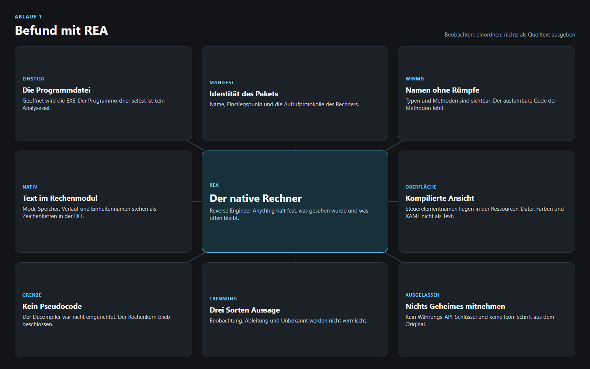
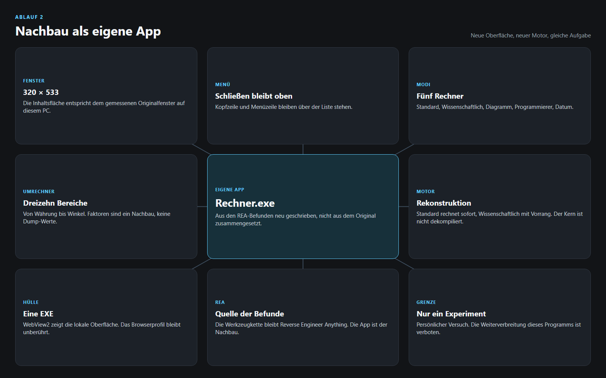
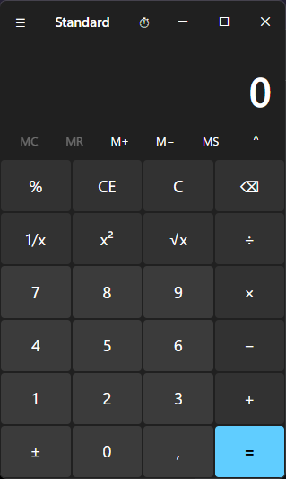

# Win Calc — REA Clone

Experimenteller Nachbau des Rechners eines bekannten Betriebssystems. Die native App wurde mit **REA: Reverse Engineer Anything** untersucht und von einer Code-CLI-KI als eigenes Programm neu gebaut. Das Ergebnis ist `release/Rechner.exe`.

Dies ist ein persönlicher Versuch auf einem einzelnen PC. **Die Weiterverbreitung dieses Programms ist verboten.** Es darf nicht weitergegeben, veröffentlicht, in andere Repositories kopiert oder als Ersatz für das Original angeboten werden.

## Überblick

Das Original ist eine gepackte Desktop-App. Die Rechnung steckt nicht in einem lesbaren Skript, und die Oberfläche liegt nicht als offenes XAML vor. REA hat die Dateien befragt, die Befunde sortiert und die Lücken offen gelassen. Daraus ist eine neue App entstanden: deutsch, lokal, mit eigener Fensterhülle.

Übernommen wurde die Aufgabe des Rechners, nicht sein Binärcode.

| | |
| --- | --- |
| Ziel | Rechner eines bekannten Betriebssystems |
| Werkzeug | REA: Reverse Engineer Anything, lokal, über die MCP-Schnittstelle |
| Umsetzung | Code-CLI-KI, HTML, CSS und JavaScript, dazu eine kleine EXE |
| Fenster | 320 × 533, gemessen am Original auf diesem PC |
| Start | `release/Rechner.exe` |

## Dank an REA

REA: Reverse Engineer Anything ist die Werkzeugkette dieser Untersuchung. Es öffnet lokale Artefakte, hält Evidence fest und trennt, was wirklich gesehen wurde, von dem, was nur abgeleitet ist.

Ohne diese Trennung wäre aus Metadaten schnell ein falscher Quelltext geworden. REA hat stattdessen geliefert, was die Dateien hergeben: Paketidentität, Typ- und Methodennamen, Zeichenketten, und die klare Grenze, wo der Rechenkern nicht lesbar war. Die neue App steht auf diesen Befunden. Sie ist kein Export aus dem Original.

## Arbeitsablauf

Zuerst der Befund, dann der Nachbau. Die beiden Bilder sind die Landkarte dazu.

### 1. Befund



Der Programmordner ließ sich nicht als Analyseziel öffnen. REA öffnet Dateien, also wurde die Programmdatei geöffnet. Das Manifest lieferte Identität, Einstiegspunkt und die Aufrufprotokolle.

Die WinMD-Datei enthält die Typen und Methodennamen der Ansicht. Die Methodenrümpfe fehlen dort: die Adressen sind leer. Sichtbar sind Namen wie Anzeige, Operand, Navigation, Datum, Umrechner, Diagramm, Verlauf und Speicher. Der ausführbare Rechenweg steht nicht in dieser Datei.

Das native Rechenmodul lieferte die Oberfläche der Funktionen als Text: Kategorien, Einheitennamen, Speicher und Verlauf. Die kompilierte Ressourcen-Datei lieferte Steuerelementnamen. Farben, Abstände und das genaue XAML waren daraus nicht als Text zu lesen.

Ein nativer Decompiler war auf diesem PC nicht eingerichtet. Es gibt deshalb keinen Pseudocode des Rechenkerns. Jede Aussage blieb in einer von drei Schubladen: Beobachtung, Ableitung oder Unbekannt.

Bewusst nicht mitgenommen wurden der Schlüssel der Währungsschnittstelle und die Icon-Schrift des Originals. Live-Kurse werden nicht abgefragt.

### 2. Nachbau



Die eigene App füllt dasselbe Inhaltsfenster, das am Original gemessen wurde: 320 × 533 Bildpunkte bei der Anzeigeskalierung dieses PCs. Die Mindestgröße aus der bekannten App-Ressource liegt bei 320 × 500. Die Kopfzeile bleibt sichtbar, wenn das Menü aufgeht. Darüber, über der Liste, bleibt die Zeile Menü stehen, damit sich das Menü schließen lässt, auch wenn die Einträge scrollen.

Die Oberfläche ist HTML, CSS und JavaScript. Die EXE ist nur die Hülle: sie packt die Dateien aus, öffnet sie in WebView2 und lässt das normale Browserprofil in Ruhe. Minimieren, Maximieren und Schließen sitzen in der Kopfzeile. Das Fenstersymbol ist das Symbol der installierten Rechner-App und gehört zu diesem lokalen Versuch, nicht in eine Weitergabe.

Der Motor ist eine Rekonstruktion:

- Standard rechnet sofort von links nach rechts. `2 + 3 × 4` ergibt 20.
- Wissenschaftlich achtet auf den Vorrang. Dieselbe Eingabe ergibt 14.
- Der Programmierer arbeitet mit ganzen Zahlen fester Breite, Zweierkomplement und den Basen 16, 10, 8 und 2.
- Umrechnungen nutzen SI- und konventionelle Faktoren. Temperatur geht über Kelvin. Die Sondergrößen sind Näherungen. Die originalen Umrechnungsdaten wurden nicht ausgelesen.
- Währung zeigt Beispielkurse in Euro und holt keine Live-Kurse.
- Das Diagramm zeichnet `y = f(x)` selbst. Es ist kein Nachbau der originalen Grafikkomponente.
- Die Datumsrechnung bildet Differenz sowie Addieren und Subtrahieren von Tagen nach.

Die deutsche Beschriftung folgt der Sprache dieses PCs. Das Paket selbst wies in der Untersuchung englische Sprachressourcen aus.

## Was die App kann

Rechner:

- Standard
- Wissenschaftlich
- Diagramm
- Programmierer
- Datumsberechnung

Umrechner:

- Währung, Volumen, Länge, Gewicht und Masse, Temperatur, Energie, Fläche, Geschwindigkeit, Zeit, Leistung, Daten, Druck, Winkel

Dazu Speicher, Verlauf und Tastatur. Die Tests in `test-engine.js` prüfen den Motor, nicht die Fensterhülle.

## Projektaufbau

```
index.html          Seite
css/app.css         Darstellung
js/engine.js        Rechenmotor
js/units.js         Einheiten
js/app.js           Oberfläche
test-engine.js      Motortests
launcher/Program.cs Fensterhülle
launcher/build.ps1  Baut die EXE neu
release/Rechner.exe Startbare App
docs/               Bilder dieser README
```

Neu bauen, im Ordner `launcher`:

```
powershell -NoProfile -ExecutionPolicy Bypass -File .\build.ps1
```

Das Skript lädt die WebView2-Bibliothek und liest das App-Symbol aus der lokalen Installation. Beides bleibt Teil dieses Experiments.

## Screenshot

So sieht der laufende Nachbau aus, aufgenommen nach dem Umzug in diesen Ordner:



## Grenze dieses Versuchs

Alles hier ist experimentell. Der Rechenkern des Originals wurde nicht dekompiliert. Gleiche Tasten bedeuten nicht bitgleiche Ergebnisse, und die Umrechner sind kein Auszug der originalen Faktor-Tabelle.

**Die Weiterverbreitung dieses Programms ist verboten.** Dazu gehören die EXE, der Quelltext, das übernommene App-Symbol und diese Bilder, sobald sie das Programm weitertragen. Der Ordner bleibt ein lokales Experiment.
